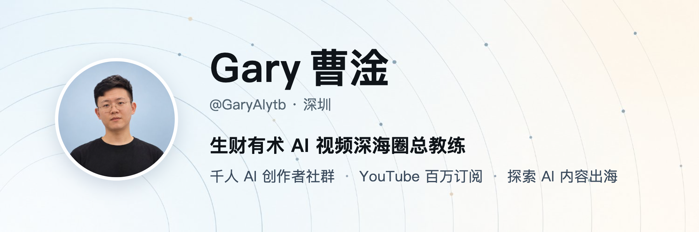

大家好，我是 Gary 曹淦，探索 AI 视频和内容出海两年的自媒体新人。

现在在生财有术带 AI 视频深海圈，一个千人规模的 AI 创作者社群，大家一起在 YouTube 上做 AI 视频、做内容出海。做视频、写内容、带团队，反复出现的活我习惯用 AI 做成工具，能开源的都放在这里。

### 最近更新

- **2026-11-14** 开源 [一镜到底：万物的一生](https://github.com/garycaogan/lifecycle-oneshot)，让 Agent 把一种植物或动物的一辈子拍成一个不切的竖屏长镜头，写稿、配音、关键帧、H3 首尾帧出片到剪辑审片一条龙
- **2026-11-10** [内容工作台](https://github.com/garycaogan/content-workbench) 的长文里能放视频和表格，一键推到公众号、X 长文和知识星球的草稿箱；长文做成的口播视频能出竖屏和横屏两版，标题、简介和封面写好后直接发到 X 或公众号
- **2026-11-04** [AI 情报站](https://github.com/garycaogan/intel-radar) 加了热点时间线，前后各半年的 AI 视频和 AI 大事分两条线排好，还能看过去一年的大热点在 YouTube 上火了多久，MCP 也能直接查

### 打开就能用

- **[AI 情报站](https://lab.ytdeepsea.com/radar/?from=github)**：每天早上自动扫一遍 B 站、YouTube、抖音、TikTok、小红书、X 和 GitHub，挑出 AI 和 AI 视频圈当天冒头的题材、热议和新工具，告诉你哪些值得马上测，每一条都写了判断依据，视频点开就能看；还有一张[热点时间线](https://lab.ytdeepsea.com/radar/timeline/?from=github)，大片、游戏、模型发布这些大热点提前半年就能看到。代码开源在 [intel-radar](https://github.com/garycaogan/intel-radar)，自备 TikHub 和大模型接口就能自己跑一套，也带 MCP，Agent 接上就能直接查。
- **[AI 像素擂台 · 小游戏](https://lab.ytdeepsea.com/games/?from=github)**：10 个 AI 拿同一份题，各写一个游戏程序，再让这些程序同场对打。现在有炸弹派对和像素拳斗两款，你可以自己上场跟它们打，也可以只看它们互相打。代码开源在 [ai-pixel-arena-games](https://github.com/garycaogan/ai-pixel-arena-games)，引擎、各家 AI 交的程序和网页版都在里面，比赛能原样复现。

### AI 视频

- **[一镜到底：万物的一生 · lifecycle-oneshot](https://github.com/garycaogan/lifecycle-oneshot)**：视频号、抖音上那种「竹子的一生」自然科普片，一种植物或动物从土里长到开花结果再回到开头，一个镜头不切，旁白一句一个阶段、念到名字出大字、穿插古诗和出处。关键帧一张接一张改，MiniMax H3 用首帧加尾帧逐段接成长镜头，一条 114 秒的片子走通一遍第三方花费 18.56 元。
- **[AI 像素擂台 · ai-pixel-arena](https://github.com/garycaogan/ai-pixel-arena)**：10 个 AI 拿一字不差的同一份提示词，各写一个贪吃蛇程序同场对打。第 1 集的提示词、裁判、各家交上来的原版程序、8470 局记录、评分、分镜和出片脚本都在里面，比赛和视频都能原样复现，换个游戏就是新的一期。
- **[换人翻拍 · mv-swap](https://github.com/garycaogan/mv-swap)**：给一条高清原片（MV、舞蹈）和几张角色图，自动切镜头、认人、在 RunningHub 上用 MiniMax H3 换人、审片重跑、超分拼片，出成片和成本报告。
- **[H3 参考图出片 · h3-ref-video](https://github.com/garycaogan/h3-ref-video)**：像给 Seedance 写提示词那样用 MiniMax H3 出视频，中文分镜自动改成官方格式，每个镜头先画一张分镜图垫给 H3，一份分镜脚本出整条片。
- **[AI 实时直播间 · ai-live-avatar](https://github.com/garycaogan/ai-live-avatar)**：让 AI 数字人自己开直播。弹幕先过滤再排队，她说完一句再接下一条，能聊天、换整套衣服、比心挥手，冷场了按自己的话题池暖场。
- **[像素日记 · pixel-diary](https://github.com/garycaogan/pixel-diary)**：用代码复刻“像素角色 + 对话框”类爆款视频，比如 B 站的“AI 接管账号”系列。一集就是一个 JSON 文件，还附了一份 Claude Code 的复刻方法 skill。

### AI 协作和内容

- **[借脑 · agent-peer-bridge](https://github.com/garycaogan/agent-peer-bridge)**：把团队里 AI 用得最好的那个人的 AI，借给每个人。Claude Code 和 Codex 跨机器互相开会话、接着聊，每个人的权限单独设。
- **[内容工作台 · content-workbench](https://github.com/garycaogan/content-workbench)**：把会议、录音、文档变成文章，划词批注改稿，正文能放图片、视频和表格，一键推进公众号、X 长文和知识星球草稿箱；长文还能做成竖屏和横屏的口播视频。
- **[深海圈 Codex 额度管理](https://github.com/garycaogan/shenhaiquan-codex-quota-manager)**：在本地管理多个 Codex 账号的额度、重置时间和 Token 消耗。

### 在别处找我

长文都发在公众号，微信扫码就能关注：

