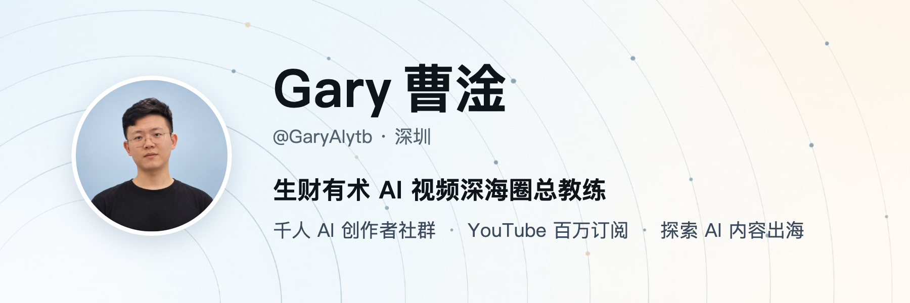

大家好，我是 Gary 曹淦，探索 AI 视频和内容出海两年的自媒体新人。

现在在生财有术带 AI 视频深海圈，一个千人规模的 AI 创作者社群，大家一起在 YouTube 上做 AI 视频、做内容出海。社群里反复出现的活，我习惯用 AI 做成工具，能开源的都放在这里。

### 开源项目

- **[借脑 · agent-peer-bridge](https://github.com/garycaogan/agent-peer-bridge)**：把团队里 AI 用得最好的那个人的 AI，借给每个人。Claude Code 和 Codex 跨机器互相开会话、接着聊，每个人的权限单独设。
- **[内容工作台 · content-workbench](https://github.com/garycaogan/content-workbench)**：把会议、录音、文档变成文章，划词批注改稿，一键推进公众号、X 长文和知识星球草稿箱。
- **[深海圈 Codex 额度管理](https://github.com/garycaogan/shenhaiquan-codex-quota-manager)**：在本地管理多个 Codex 账号的额度、重置时间和 Token 消耗。

### 在别处找我

长文都发在公众号，微信扫码就能关注：

